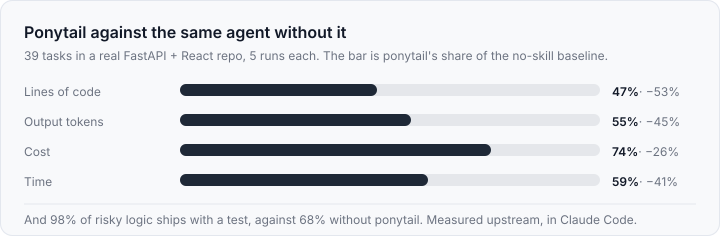
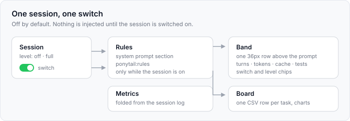

# dsh-ponytail

English | [中文](README.zh.md)

Ponytail as a DeepSeek Harness plugin: a per-session lazy-senior-dev mode, the
`/ponytail` command family, the band above the prompt, and a board of every task.

Converted from [DietrichGebert/ponytail](https://github.com/DietrichGebert/ponytail) 5.3.3 (MIT).
The six skills, the rules text, the level semantics, the `shortcut:` debt
ledger, and the band/board metrics keep upstream's shape.

## Why it is lighter

Ponytail is one prompt and one ladder: before writing code, stop at the first rung
that holds — does it need to exist, is it already here, does the standard library
do it, is it one line. The published benchmark of the upstream prompt, measured in
Claude Code against the same agent without it:



These are upstream's figures for the prompt in Claude Code, not a measurement of
this plugin on DeepSeek Harness; the plugin ships that prompt and reports what a
session actually spends, so you can check the same four numbers on your own work
in the band and the board.

## Install

From this repository, nothing to build:

```
plugin_manager install_bundle target=github:owlzo/dsh-ponytail
```

From the plugin market index this repo publishes, add the index URL in
Settings → Discover, then install:

```
https://raw.githubusercontent.com/owlzo/dsh-ponytail/main/index.json
```

From a local checkout, point the same tool at the directory:

```
plugin_manager install_bundle target=<this directory>
```

中文：在 DSH 里让助手调用 `plugin_manager install_bundle target=github:owlzo/dsh-ponytail`
即可安装；也可以把上面的 `index.json` 地址加进 Settings → Discover 的索引源，
在“发现”里点安装。装好后在会话里打开 ponytail 横条右侧的开关才会生效。

## What it does




| Surface | Where | What |
|---|---|---|
| Rules | system prompt, section `ponytail:rules` | That session's ruleset, injected on every request while its own switch is on. |
| Skills | `ctx.skills` | `ponytail`, `ponytail-review`, `ponytail-audit`, `ponytail-debt`, `ponytail-gain`, `ponytail-help`, shipped with the plugin. |
| Commands | `/ponytail`, `/ponytail-review`, `/ponytail-audit`, `/ponytail-debt`, `/ponytail-gain`, `/ponytail-help` | Level switching, the review/audit prompts, the debt ledger, the scoreboard. |
| Band | `conversation.input.dock` | One 36px row in the same dock column and menu surface as the Goal/Queue cards. Off by default: just the name and a switch on the right. Switched on: level chips, turns, tokens, agent time, reuse, test state and cost, four icon actions, and an optional second card: project and task name, start time and agent time, then input / output / cached tokens with the cache share, files touched, cost and model. |
| Board | `main` panel `ponytail` + sidebar icon | Totals with per-task averages, then a two-column grid: tokens per day (hover a bar for that day's numbers), test health, the reuse trend (hover a point), and the project ranking, then the latest tasks. A task row opens its Session. |

Ponytail is **per session and off by default**: a session injects nothing until
its switch (right side of the band) or `/ponytail lite|full|ultra` turns it on.
A bare `/ponytail` reports the session's level, or turns it on to the switch
level. `/ponytail default <level>` picks what the switch turns on to.
`/ponytail band [on|off]` shows or hides the band for the whole app. Typing
`stop ponytail` or `normal mode` alone turns that session off, as upstream does.

A task is named by its goal, then by its session title, then by the first human
prompt; the first prompt stays readable in the detail card. The band and the
board rebuild each session's numbers from its own log, so a plugin reload, or an
install in the middle of a session, still shows the turns, tokens and the last
test result instead of "not run".

The plugin needs no configuration. Command results are in Chinese: the level
messages, the debt ledger, the scoreboard and the help text. The skills keep
upstream's English instructions, and the review/audit commands add "报告用中文写"
to the prompt so the report itself comes back in Chinese. Optional fields, when
the bundle row is edited:

```yaml
- id: ponytail
  name: dsh-ponytail
  config:
    ledger: true          # write one row per task to the board
    prices:               # USD per 1M tokens, per model; without it cost stays unset
      deepseek-v4.1-flash: { input: 0.15, output: 0.6, cacheRead: 0.015 }
```

## Data

- State (per-session levels, the switch level, band visibility):
  `<config>/ponytail/state.json`, where
  `<config>` is `$XDG_CONFIG_HOME`, else `%APPDATA%` on Windows, else `~/.config`.
- Board: `<config>/ponytail/band/<project>.csv`, one row per task, in upstream's
  column order plus a trailing `session` column that lets a row open its
  conversation. Upstream reads by column name, so the extra column is inert
  there and is dropped if a Claude Code board rewrites the file; the row then
  simply stops being clickable.
- Default level: `PONYTAIL_DEFAULT_MODE`, then `config.json`'s `defaultMode`,
  then `full` — upstream's resolution order.

## Where this differs from the Claude Code plugin

- **One level per session, off by default.** Upstream keeps one flag file per
  machine; here each session owns its level, and a new session starts off. Only
  sessions that were switched on produce board rows.
- **The API answers this machine only.** `/ponytail/api/*` skips the browser
  cookie, so it refuses any request whose socket is not loopback.
- **Cost needs a price table.** The Harness records tokens, not money. A task on
  a model with no `prices` entry leaves its cost cell empty, and the board says
  how many tasks are unpriced instead of counting them as free.
- **The band is a slot, not a terminal row.** It is a React entry above the
  composer, so its actions prefill and submit the composer (`/ponytail-review`,
  …) and the board opens as a `main` panel instead of a local page.
- **Reuse and tests come from the session log.** `edit` counts as reuse, `write`
  as new, and the last test command's outcome is read from its tool result.

## Release

The repository publishes two things: the package itself (installable from the
Git URL) and `index.json`, a [plugin market index](https://github.com/deepseek-ai/deepseek-harness)
(``format: 1``) that pins each version to a commit.

1. Bump `version` in `package.json`.
2. `npm run index` — writes `index.json` with the current commit and timestamp.
3. Commit both, then `git tag v<version> && git push --follow-tags`.
4. Existing installs update with `plugin_manager` (it reads the market entry's
   pinned commit), or a fresh install from the Git URL picks up the new commit.

## Checks

```
npm run verify:setup   # fetch the two React UMD files the fixture loads
npm test               # 22 host tests: rules, skills, commands, metrics, ledger, charts, debt, routes
npm run check          # headless Chrome: mounts both surfaces in light and dark,
                       # clicks them, and prints geometry plus WCAG contrast ratios
```

`verify/fixture/` is a throwaway page (React 18 UMD plus the real `client.js`)
used only by that render check; it carries the resolved light and dark token
values from `ui-theme`. The React files stay out of git; `npm run verify:setup`
fetches them.

## License

MIT, same as upstream. The rules, skills and command semantics come from
DietrichGebert/ponytail; the Harness integration is new. `LICENSE` keeps upstream's
copyright notice because this package ships upstream's skill text verbatim.
