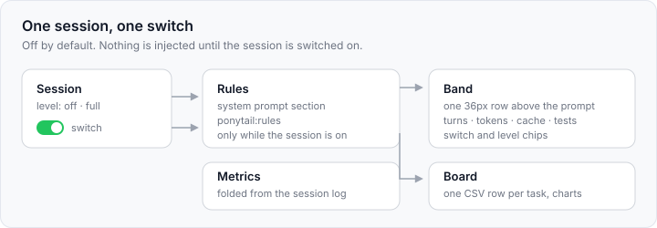
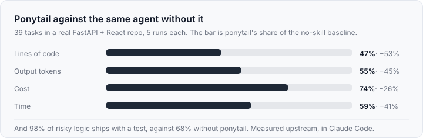

# dsh-ponytail

[English](README.md) | 中文

Ponytail 的 DeepSeek Harness 插件：按会话开启的“懒惰资深开发模式”、
`/ponytail` 命令族、提示词上方的 band，以及一份任务看板。

移植自 [DietrichGebert/ponytail](https://github.com/DietrichGebert/ponytail) 5.3.3（MIT）。
六个技能、规则文本、级别语义、`shortcut:` 债务账本、band/看板指标都沿用上游的形状。

## 它做什么



| 位置 | 落点 | 内容 |
|---|---|---|
| 规则 | 系统提示词 `ponytail:rules` 段 | 该会话的规则集，只在这个会话的开关打开时注入。 |
| 技能 | `ctx.skills` | `ponytail`、`ponytail-review`、`ponytail-audit`、`ponytail-debt`、`ponytail-gain`、`ponytail-help`，随插件分发。 |
| 命令 | `/ponytail`、`/ponytail-review`、`/ponytail-audit`、`/ponytail-debt`、`/ponytail-gain`、`/ponytail-help` | 级别切换、审阅/审计提示词、债务账本、成绩单。 |
| Band | `conversation.input.dock` | 一行 36px，和 Goal/Queue 卡片同列同表面。默认关闭：只有名字和右侧开关。打开后：级别按钮、轮数、token、agent 时间、复用率、测试状态、花费，四个图标动作，以及可展开的第二张卡：项目与任务名、开始时间与 agent 时间，然后是输入/输出/缓存 token 与缓存命中率、改动文件、花费、模型。 |
| 看板 | `main` 面板 `ponytail` + 侧栏图标 | 总量与每任务均值，然后两列网格：每日 token（悬停柱子看当天数字）、测试健康、复用率趋势（悬停数据点）、项目排行，最后是最近任务；点一行跳到对应会话。 |

Ponytail 是**按会话、默认关闭**的：会话在右侧开关或 `/ponytail lite|full|ultra`
打开之前不注入任何东西。裸 `/ponytail` 报告当前会话级别，关闭状态下则按“开启级别”打开；
`/ponytail default <level>` 设定开关打开时用哪一档；`/ponytail band [on|off]` 控制整个
应用的横条显示；单独说 `stop ponytail` 或 `normal mode` 只关掉当前会话（与上游一致）。

任务名按“目标 → 会话标题 → 首条用户消息”取值，首条消息仍保留在详情卡里。band 和看板
会从会话日志重建每个会话的数据，所以插件重载、或会话进行到一半才安装，也能看到已有的
轮数、token 和最后一次测试结果，而不是“未运行”。

插件无需配置。命令返回文本是中文：级别提示、债务账本、成绩单、帮助。技能正文保留上游的
英文指令，审阅/审计命令会追加“报告用中文写”，让报告正文用中文回来。可选配置（编辑 bundle 行时）：

```yaml
- id: ponytail
  name: dsh-ponytail
  config:
    ledger: true          # 每个任务往看板写一行
    prices:               # 每百万 token 的美元单价，按模型配置；不配则花费留空
      deepseek-v4.1-flash: { input: 0.15, output: 0.6, cacheRead: 0.015 }
```

## 为什么更省

Ponytail 只有一段提示词和一把梯子：写代码之前，停在第一级能站住的台阶——这东西需要存在吗、
代码里已经有了吗、标准库能做吗、能不能一行。上游在 Claude Code 里对同一模型做过基准：



这些是**上游在 Claude Code 上的测量**，不是本插件在 DeepSeek Harness 上的实测；插件把那段
提示词搬了过来，并把一次会话真实花掉的东西显示在 band 与看板里，你可以用同样的四个维度检查
自己的工作。

## 安装

从本仓库安装，无需构建：

```
plugin_manager install_bundle target=github:owlzo/dsh-ponytail
```

从本仓库发布的插件市场索引安装：在 Settings → Discover 里添加索引地址，然后安装：

```
https://raw.githubusercontent.com/owlzo/dsh-ponytail/main/index.json
```

从本地目录安装：

```
plugin_manager install_bundle target=<this directory>
```

装好后，在会话里打开 ponytail 横条右侧的开关才会生效。

## 数据

- 状态（每个会话的级别、开关级别、横条可见性）：
  `<config>/ponytail/state.json`，其中 `<config>` 是 `$XDG_CONFIG_HOME`，Windows 上是
  `%APPDATA%`，否则 `~/.config`。
- 看板：`<config>/ponytail/band/<project>.csv`，每个任务一行，沿用上游列序，并在末尾追加
  一列 `session`，让一行能打开对应会话。上游按列名读取，所以多出的列对它无副作用；如果
  Claude Code 侧重写了该文件，这列会消失，行只是不再可点。
- 默认级别：`PONYTAIL_DEFAULT_MODE`，然后 `config.json` 的 `defaultMode`，最后 `full`
  —— 上游的解析顺序。

## 与 Claude Code 版的不同

- **每个会话一个级别，默认关闭。** 上游是每台机器一个标记文件；这里每个会话有自己的级别，
  新会话从关闭开始，只有被打开过的会话才会产生看板行。
- **接口只应答本机。** `/ponytail/api/*` 不经过浏览器 cookie，因此拒绝任何非回环 socket 的请求。
- **花费需要价目表。** Harness 只记录 token，不记钱。没有对应 `prices` 的任务，花费单元格留空，
  看板会告诉你有多少个任务没有价格，而不是把它们当作免费。
- **band 是一个插槽，不是终端行。** 它是输入框上方的 React 条目，所以它的动作是把
  `/ponytail-review` 之类填进输入框并提交，看板是 `main` 面板而不是本地网页。
- **复用与测试来自会话日志。** `edit` 记为复用、`write` 记为新建，最后一次测试命令的
  结果取自它的工具结果。

## 发布

仓库发布两样东西：包本身（可从 Git URL 安装）和 `index.json`——一个
[插件市场索引](https://github.com/deepseek-ai/deepseek-harness)（``format: 1``），
把每个版本固定到具体 commit。

1. 修改 `package.json` 的 `version`。
2. `npm run index` —— 用当前 commit 与时间戳重写 `index.json`。
3. 提交两者，然后 `git tag v<version> && git push --follow-tags`。
4. 已安装的用户按索引里的新版本重装；新安装从 Git URL 拿到最新 commit。

## 自检

```
npm run verify:setup   # 拉取 fixture 需要的两个 React UMD 文件
npm test               # 22 项宿主测试：规则、技能、命令、指标、账本、图表、债务、路由
npm run check          # headless Chrome：在浅色/深色下挂载两个界面、点击，并打印尺寸与对比度
```

`verify/fixture/` 只给渲染检查用的临时页面（React 18 UMD + 真实的 `client.js`），
里面带着 `ui-theme` 解析后的浅色/深色 token 值。React 文件不入库，用
`npm run verify:setup` 拉取。

## 许可证

MIT，与上游一致。规则、技能与命令语义来自 DietrichGebert/ponytail；Harness 集成是新的。
`LICENSE` 保留上游版权声明，因为本包逐字分发上游的技能文本。
